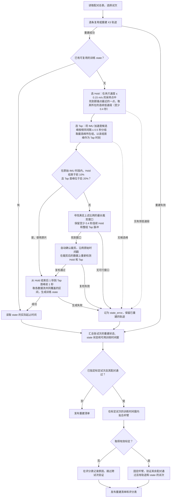

# 单机 X3 批量重建与 Vicon 验证

用同一条命令逐条重建 X3 轨迹并生成训练 state。要验证轨迹的位置误差，可指定一条标定试次，拟合相机与 Vicon 刚体之间的固定位置偏移（杆臂），再用这组杆臂验证其他试次。[批处理脚本](../scripts/reconstruct_and_calibrate.sh)

## 使用方法

先完成时间配对，使所选试次都在配对目录的 `summary.csv` 中有记录。配对状态决定试次能否参与 Vicon 评估，所有选中的试次都会尝试重建。单机原片放在任务目录的 `single/raw/x3/trial_YYMMDD_NNN/`。[时间对齐指南](temporal_pairing_with_vicon.md)

从项目根目录运行，替换尖括号中的任务名、试次号和现场锚点参数。

```bash
bash scripts/reconstruct_and_calibrate.sh \
  --dataset 'datasets/<任务名>' --trials '<NNN>' \
  --anchor-ids '<ID,ID,...>' --anchor-size '<anchor_size_m>'
```

要做跨试次验证，在同一条命令中选入标定和验证试次，并用 `--calibration` 指定其中一条。各试次应保持相同的相机与刚体安装关系。例如，以下命令选择三条试次，用第一条标定。

```bash
bash scripts/reconstruct_and_calibrate.sh \
  --dataset 'datasets/<任务名>' --trials 001 002 003 \
  --anchor-ids '<ID,ID,...>' --anchor-size '<anchor_size_m>' \
  --calibration 001
```

## 参数

| 参数 | 说明 |
|---|---|
| `--dataset 'datasets/<任务名>'` | 必填。传入包含 `single/` 的任务根目录。 |
| `--anchor-ids '<ID,ID,...>'` | 必填。填写互不重复的非负整数，用逗号分隔。首个 ID 是参考锚点。 |
| `--anchor-size '<anchor_size_m>'` | 必填。锚点标签内方形的实际边长，单位为米。 |
| `--trials '<NNN>'` | 可选。传入一个或多个三位试次号，也可使用 Bash 范围，如 `{001..010}`。省略时处理配对总表中的全部试次。 |
| `--calibration '<NNN>'` | 可选。指定所选试次中的一条用于拟合杆臂。省略时只执行重建和 state 生成。 |
| `--pairing-dir '<配对目录>'` | 默认读取任务下的 `single/pairing/`。若配对时自定义了输出目录，在这里传入同一路径。 |
| `--output-dir '<输出目录>'` | 批次清单、日志和评分的输出目录，默认为 `single/reconstruction/`。各试次的重建轨迹和 state 存放在 `single/processed/`。 |

## 程序框图



## 输出与重跑

先看输出目录下的 `reconstruction.csv`。每条试次一行，`built` 表示本次生成，`reused` 表示复用已有结果。`estimate` 和 `state_rrd` 给出实际文件路径，`state_start_s` 和 `state_end_s` 给出训练 state 在原视频时间轴上的起止秒数。

| 路径（相对于输出目录） | 用途 |
|---|---|
| `reconstruction.csv` | 最近一次已发布批次的重建清单。遇到 `reconstruction_error` 或 `state_error` 时，查看该次运行的 `logs/<NNN>_reconstruction.log`。 |
| `summary.csv` | 最近一次产生评分表的批次。只做重建时，已有评分表沿用上一次结果。两张表各自只包含对应批次的试次。 |
| `history/run_*/`、`latest/` | 每次运行有独立的参数、日志和清单。`latest/` 指向最近一次已发布的运行。 |
| `history/run_*/calibration.json` | 成功标定时生成。`lever_m` 是用于验证的三维杆臂，单位为米。 |
| `history/run_*/scores/`、`history/run_*/paired_mocap/` | 保存该次评分产生的逐帧误差文件，以及供复核的已对时 Vicon 轨迹。 |

**读评分表。** 查看跨试次精度时，选取 `stage=holdout` 且 `status=pass` 的行。`candidate` 行给出标定试次自身的拟合残差。每条试次只统计其训练 state 时间窗内有 Vicon 覆盖的关键帧。`full_frames` 是有效帧数，`full_p50_mm`、`full_p90_mm` 和 `full_p99_mm` 分别是位置误差的第 50、90 和 99 百分位数，单位为毫米。`scale_rejected` 表示尺度检查未通过。

要查看误差曲线，在项目根目录将所选评分运行的路径传给绘图脚本。图像写入该运行目录的 `keyframe_errors.png`。

```bash
.venv/bin/python ../vicon/processing/plot_batch_errors.py '<输出目录>/history/<评分运行目录>'
```

**重跑或更换配置。** 使用相同锚点参数重跑时，脚本复用同会话的完整重建和可用 state。已有轨迹而缺 state 时，只补做 state；需要裁剪时批处理自动确认可行窗口。若生成失败，轨迹仍可复用，原因见试次目录的 `reports/state.log`。更换锚点且主目录已有其他配置时，新轨迹写入 `single/processed/anchors_<配置>/<试次>/`。只更换 `--calibration` 时，脚本复用匹配的重建和 state，用新的标定试次重新拟合并验证。
