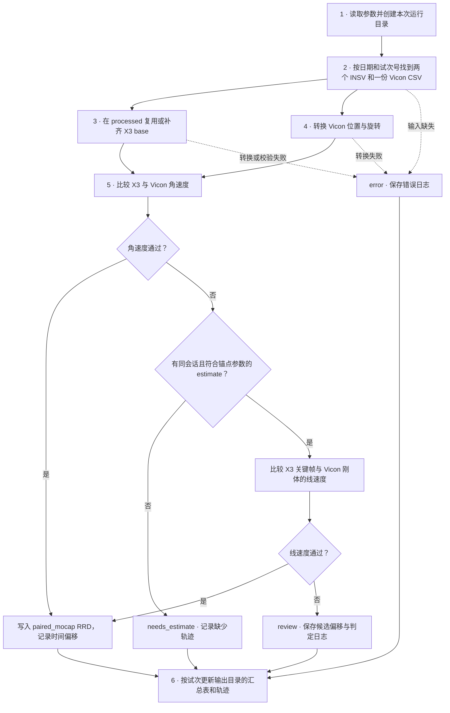

# 单机 X3 与 Vicon 时间对齐

配对脚本估计每条试次的 X3 与 Vicon 时间偏移，并把通过配对的 Vicon 刚体轨迹写到 X3 时间轴上。[配对脚本](../scripts/pair_x3_vicon.sh)

## 使用方法

将每条试次的两份 X3 原片放在 `single/raw/x3/trial_YYMMDD_NNN/`，文件名除镜头编号 `_00_` 和 `_10_` 外应一致。将对应的 Vicon Tracker CSV 放在 `single/raw/vicon/`，文件名以 `_YYMMDD_NNN.csv` 结尾。每个请求的三位试次号应只对应一个试次目录和一份同日期的 CSV。

从项目根目录运行，替换尖括号中的任务名和试次号。项目使用本地 `.venv`，并从同级 `vicon` 仓库调用 `processing/vicon_to_motive.py`。[环境配置](workflow.md)

```bash
bash scripts/pair_x3_vicon.sh --dataset 'datasets/<任务名>' --trials '<NNN>'
```

## 参数

| 参数 | 说明 |
|---|---|
| `--dataset 'datasets/<任务名>'` | 必填。传入包含 `single/` 的任务根目录。 |
| `--trials '<NNN>'` | 必填。可列出多个三位试次号，如 `--trials 001 003`。连续试次可用 Bash 范围，如 `--trials {001..010}`。 |
| `--anchor-ids '<ID,ID,...>'` | 可选。线速度回退时，用这些 ID 筛选已有轨迹。首个 ID 是参考锚点，省略时不限 ID。 |
| `--anchor-size '<anchor_size_m>'` | 可选。锚点标签内方形边长，单位为米。线速度回退时按此值筛选已有轨迹，省略时不限边长。 |
| `--min-overlap-fraction <比例>` | 两条运动曲线的重叠时长至少占较短曲线的比例。取值为 0 到 1，默认 `0.5`，对角速度和线速度匹配均生效。 |
| `--output-dir '<输出目录>'` | 配对结果的写入目录。按上述布局，默认为任务根目录下的 `single/pairing/`。 |

## 程序框图



## 对照脚本的六个版块

| 版块 | 脚本行为 |
|---|---|
| 1. 参数与输出目录 | 检查参数和试次号，锁定输出目录，为本次运行创建独立目录并记录参数。 |
| 2. 核对输入 | 按日期和试次号查找双镜头 INSV 与 Vicon CSV，检查文件是否可读。 |
| 3. 获取 X3 base | 校验并复用 `single/processed/<试次>/base/`。缺少 base 时，从双镜头原片生成。 |
| 4. 转换 Vicon 轨迹 | 将 Tracker CSV 中以毫米表示的位置换算为米，将轴角旋转转换为四元数。 |
| 5. 匹配时间 | 优先比较 X3 陀螺仪和 Vicon 刚体的角速度模长。未通过时，使用同会话且符合所给锚点参数的已有位置轨迹比较线速度。匹配要求相关系数 ≥ 0.50、主次峰值比 ≥ 1.20。 |
| 6. 汇总结果 | 每条试次写一行判定。单条出错后继续处理其余试次，批次结束时按试次号更新总表。 |

## 输出与重跑

先看输出目录下的 `summary.csv`。每个试次一行，`trial` 是试次号，`session_id` 是 X3 会话 ID，`status` 给出最近一次完成的判定。

| 状态 | 如何读取或处理 |
|---|---|
| `pass` | `signal` 为 `rotation`（角速度）或 `speed`（线速度），`corr` 为相关系数。偏移量 `offset_s` 以秒计，方向为 **Vicon 时间 = X3 时间 + offset_s**。 |
| `needs_estimate` | 角速度匹配未通过。补齐符合锚点参数的同会话 X3 位置轨迹后，可重跑该试次。 |
| `review` | 线速度回退后仍未通过。查看同步日志里的候选偏移和峰值比。 |
| `error` | 输入检查或处理失败。查看该试次的处理日志定位原因。批次中有此状态时，脚本退出码为 1。 |

下列路径相对于配对输出目录。指定 `--output-dir` 时，到指定目录查看。

| 路径 | 内容 |
|---|---|
| `paired_mocap/<会话>.rrd` | 已对齐到 X3 时间轴的 Vicon 轨迹，可按总表里的 `session_id` 查找。 |
| `motive_csv/` | 转换后的 Vicon CSV，沿用原文件名。 |
| `run_*/` | 每次运行的参数 `parameters.txt`、仅含本次试次的 `summary.csv` 和日志目录 `logs/`。 |
| `latest/` | 指向最近一次完成的运行。`logs/<NNN>_process.log` 记录输入检查和处理过程，进入时间匹配阶段后还会生成 `logs/<NNN>_sync.log`。 |

重跑时沿用同一输出目录，在 `--trials` 中只填需要更新的试次号。新判定替换总表中对应的行。若某条从 `pass` 变为未通过，脚本会移除该试次先前发布的配对轨迹。
